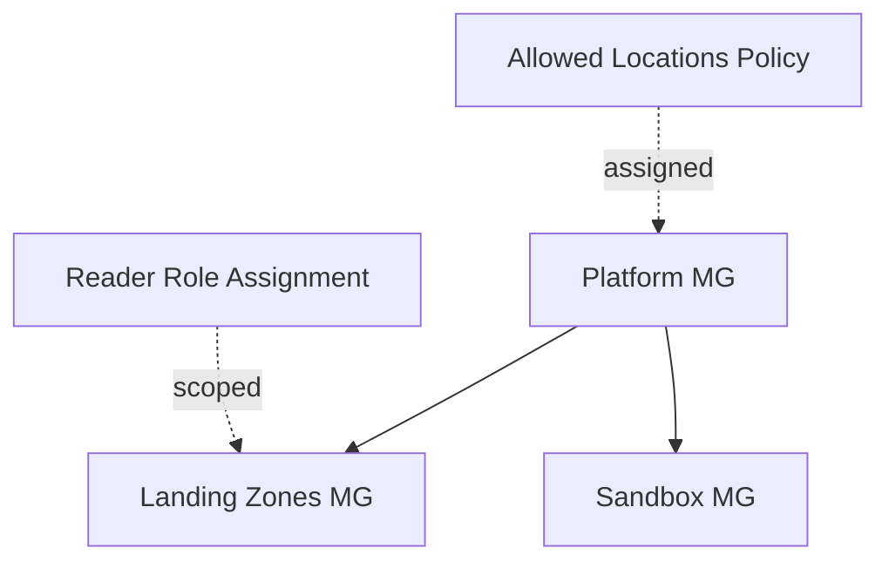

# Azure Enterprise Landing Zone — Governance (Terraform)

> Management group hierarchy, an Azure Policy guardrail, and RBAC — the governance backbone of an Azure landing zone, provisioned with Terraform.
> **Author:** Muhammad Ahmad · **IaC:** Terraform · **Cloud:** Azure


---

## 📌 Overview

- A **management group hierarchy**: a `platform` parent with `landingzones` and `sandbox` children.
- An **Azure Policy** assignment (built-in *Allowed locations*) on the platform group, so every child subscription can only deploy into approved regions.
- A **RBAC** role assignment (`Reader`) scoped to the Landing Zones group.

This is the structure you apply before onboarding workload subscriptions.

## 🏗️ Architecture

> 🎨 **Interactive diagram (industry-standard icons):** [open in Lucid — page 15](https://lucid.app/lucidchart/3da75ce3-ea66-4296-81b3-00d20a60435b/edit)



## ⚠️ Prerequisites

Run with an identity that has **Management Group Contributor** and the rights to create policy/role assignments at the tenant root.

## 🚀 Deploy

```bash
cd terraform
az login
terraform init
terraform apply
```

## 🧹 Clean up

```bash
terraform destroy
```

## 🔐 Production hardening (next steps)

- Add a full **CAF management-group** tree (Decommissioned, Connectivity, Identity).
- Assign **policy initiatives** (Security Benchmark) with `deployIfNotExists`.
- Drive RBAC from **Azure AD groups**, not individual principals.

---

*Built and maintained by **Muhammad Ahmad**.*
