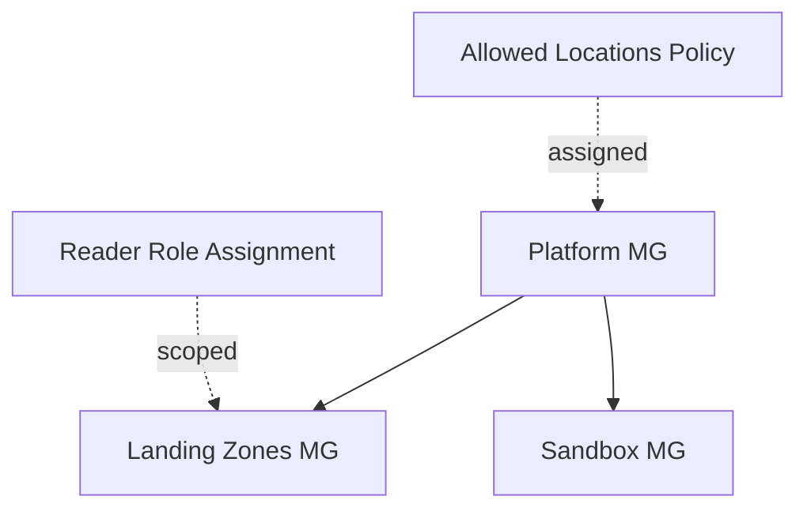

# Architecture Diagram — Azure Governance Landing Zone

## Lucid diagram

- **View:** https://lucid.app/lucidchart/f7c2cc20-ac81-4ce8-a026-513e1fdca56e/view
- **Edit:** https://lucid.app/lucidchart/f7c2cc20-ac81-4ce8-a026-513e1fdca56e/edit

## Lucid prompt (reusable)

```
Create an Azure governance diagram titled "Azure Enterprise Landing Zone Governance".
A Platform management group is the parent of two child management groups: Landing Zones
and Sandbox. An Allowed-Locations Azure Policy is assigned to the Platform group, and a
Reader RBAC role assignment is scoped to the Landing Zones group. Clean, professional
Azure colors.
```

## Mermaid source


