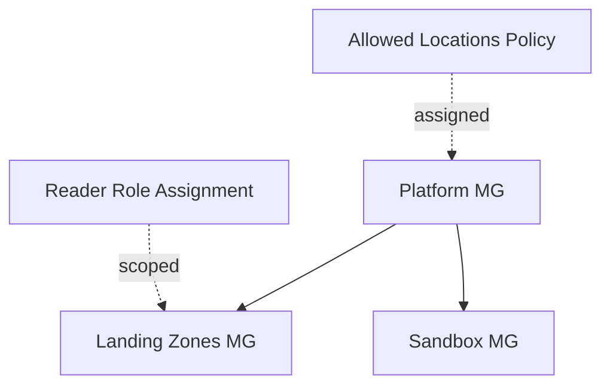

# Architecture Diagram — Azure Governance Landing Zone

## Lucid diagram

- **Master Lucid document (all 30 diagrams, icon style):** https://lucid.app/lucidchart/3da75ce3-ea66-4296-81b3-00d20a60435b/edit
- This project is **page 15** of that document.

## Lucid prompt (reusable)

```
Create an Azure governance diagram titled "Azure Enterprise Landing Zone Governance".
A Platform management group is the parent of two child management groups: Landing Zones
and Sandbox. An Allowed-Locations Azure Policy is assigned to the Platform group, and a
Reader RBAC role assignment is scoped to the Landing Zones group. Clean, professional
Azure colors.
```

## Mermaid source


